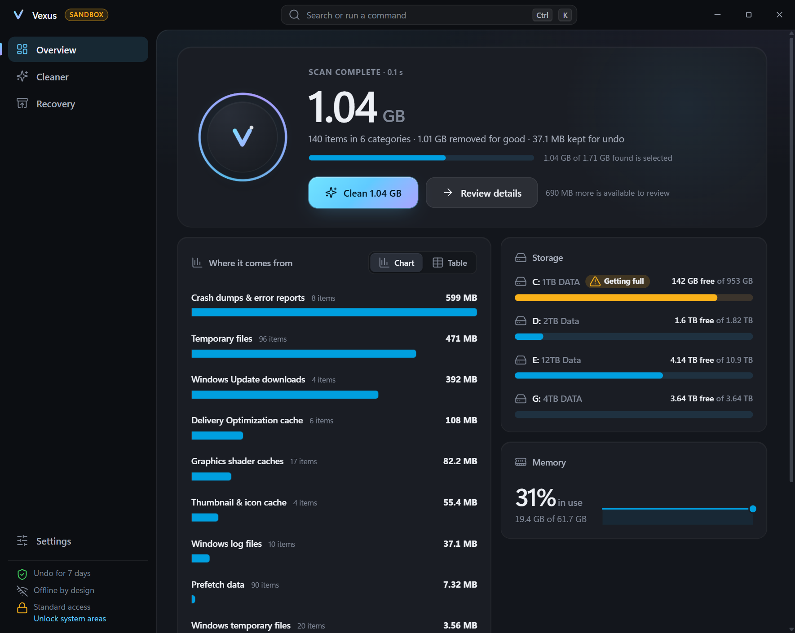
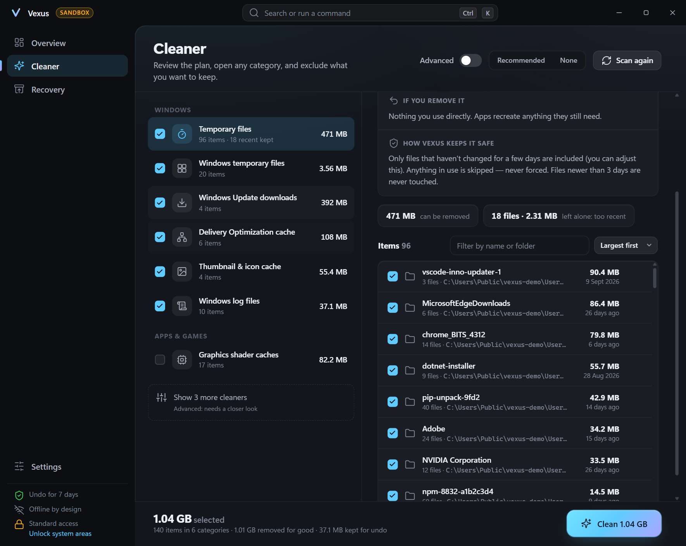
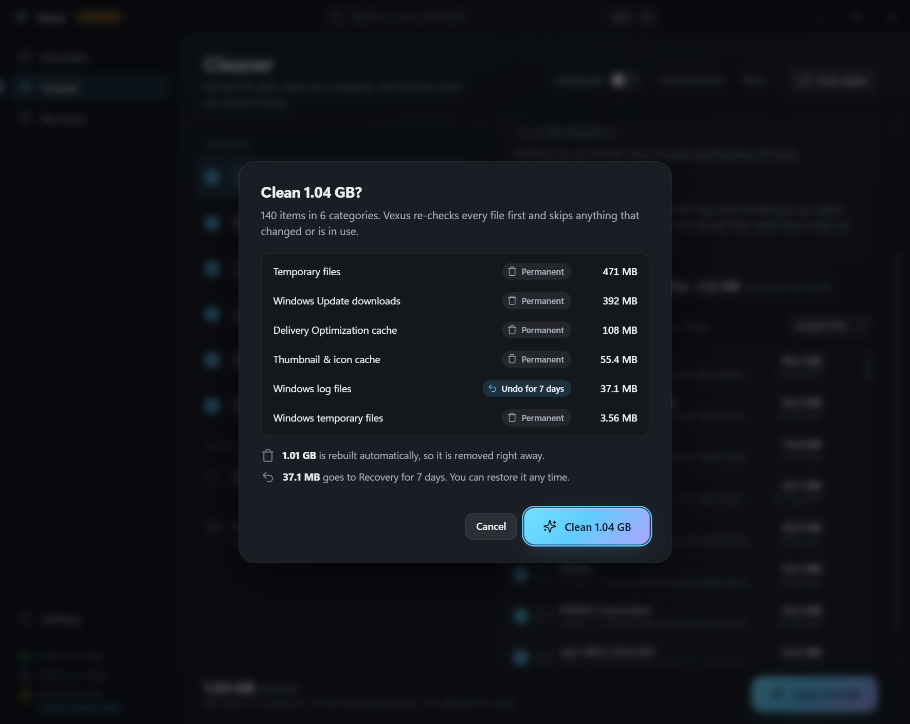
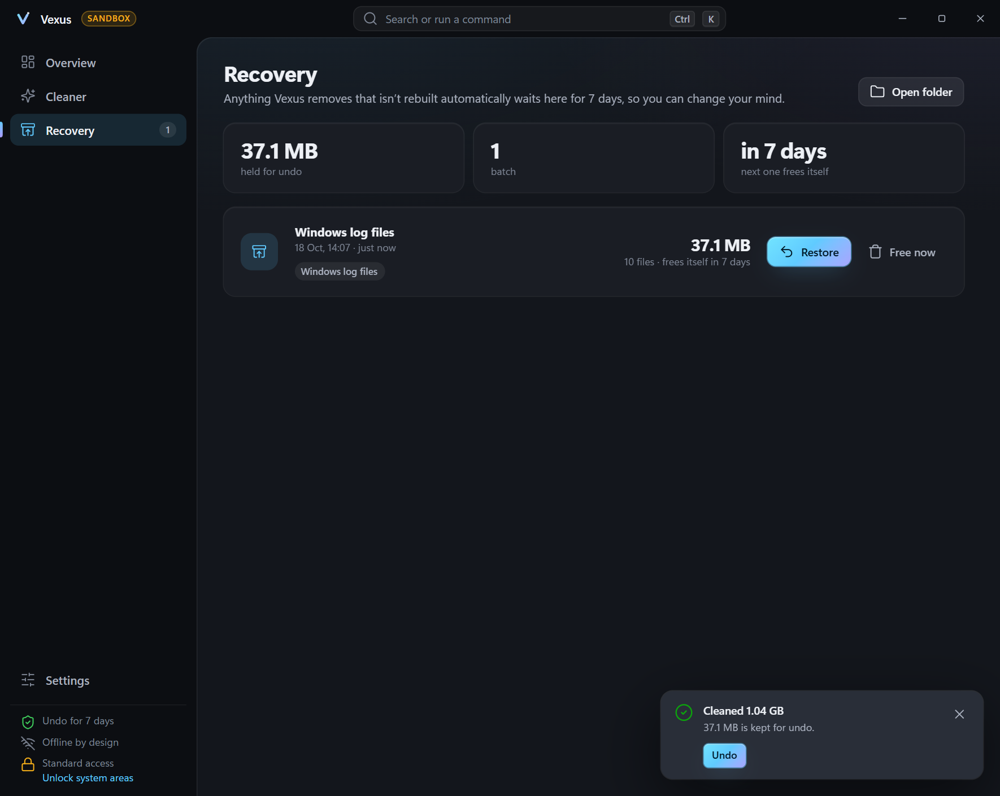
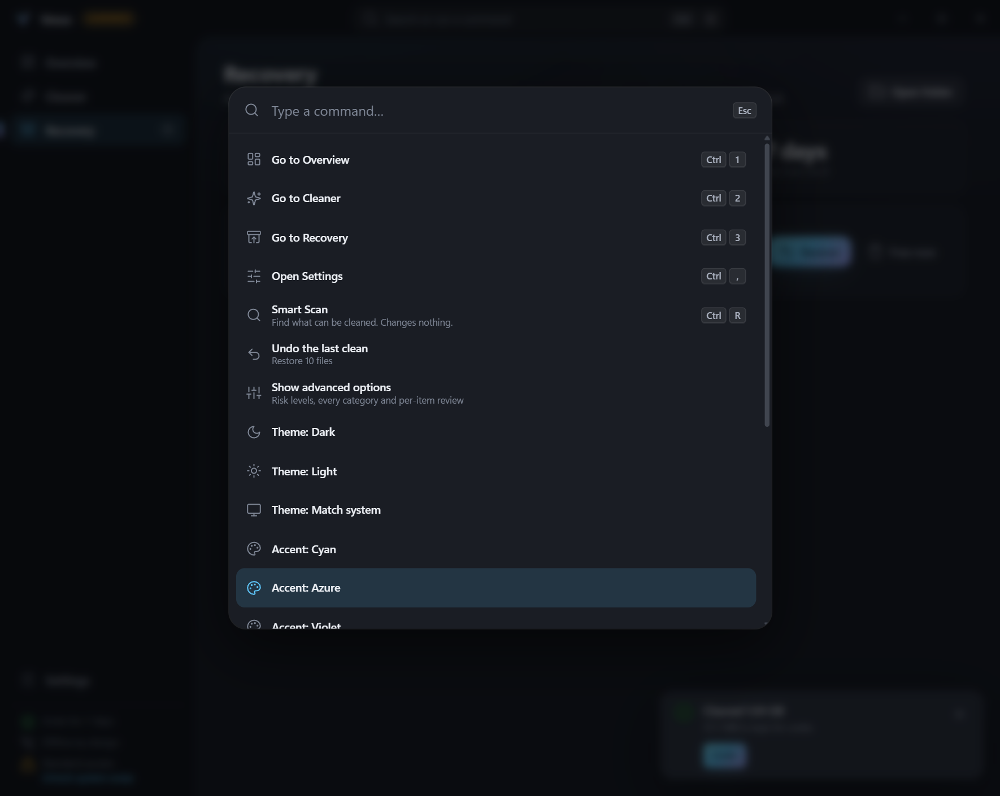
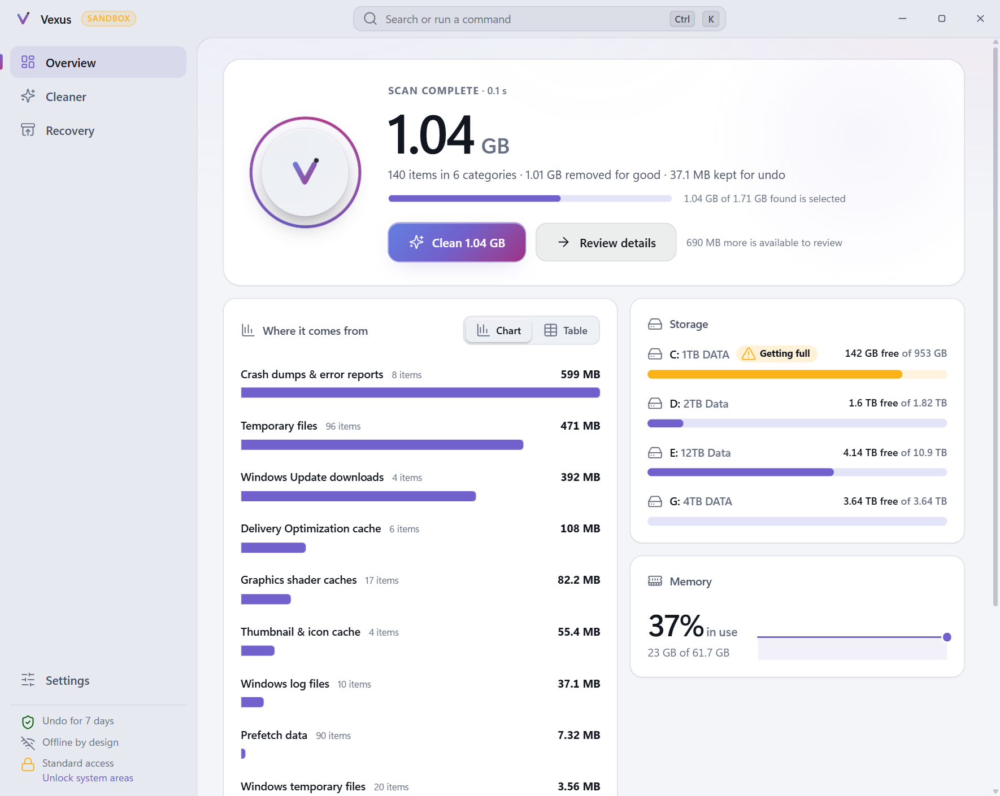

# Vexus

**A Windows cleaner you can trust, because it shows its work.**
Fast, calm, offline — built in Rust with a native-feeling Tauri 2 interface.

<p align="center">
  
</p>

Vexus finds the junk Windows and your apps leave behind, tells you exactly what each item is and what removing it does, lets you exclude anything, and only then cleans — re-checking every file at the last moment. What isn't regenerable goes to a **Recovery** store first, so cleaning is never a one-way door.

* **Safe by construction.** A default-deny path guard, handle-verified deletion that is immune to directory-swap tricks, links never followed, files in use never forced. → [`docs/SAFETY.md`](docs/SAFETY.md)
* **Transparent.** Plain-language explanations for every category, an exact per-item preview, a sticky bar that always says what *Clean* will do, and local logs of everything done.
* **Offline, no telemetry.** No network code at all; the UI runs under a strict CSP.
* **Light.** The release app is ~6 MB; the installers are 2–3 MB. No Node, no Electron, no bundler.
* **Fast.** On the development PC a real scan of ≈90,000 entries took 0.2–1 s, and a synthetic 100,000-file plan scanned in 40–450 ms (warm/cold cache) and was cleaned in 2–4 s — roughly 25,000–40,000 files/s depending on the disk, each one re-verified through a handle. Paging, searching and sorting those 100,000 items takes single-digit milliseconds. Results stream in as each category finishes.

**Download:** installers and a portable zip are on the [Releases page](https://github.com/Mythrax-ZS/Vexus/releases/latest). They are not code-signed yet, so Windows SmartScreen may ask you to confirm the first run.

> **Status: v0.1 — the first slice.** The engine, the safety model, the scanner/cleaner/undo and the full desktop shell are done and tested. Browser cleaning, the disk analyzer, startup manager and optimizer are next (see the [roadmap](#roadmap)); they are not in this build.

## What works today

| Area | |
|---|---|
| **Cleaner** — user & Windows temp, Windows Update downloads, Delivery Optimization cache, thumbnail/icon cache, Prefetch, crash dumps & error reports, Windows logs, recent files & jump lists, graphics shader caches, Recycle Bin | ✅ scan · preview · exclude · clean |
| **Safety** — risk levels, age gates, locked-file handling, undo window, deletion policy, sandbox mode | ✅ |
| **Recovery** — restore or free any batch, auto-expiry, survives crashes | ✅ |
| **Overview** — live disk and memory, ranked breakdown with table view, state-aware hero (scanning, ETA, done, undo) | ✅ |
| **UX** — command palette (`Ctrl+K`), shortcuts, light/dark/system theme, any accent colour, reduced motion, onboarding, tray with live status | ✅ |
| **Elevation** — admin-only categories are shown locked; *Restart as administrator* on request | ✅ <sub>(the UAC relaunch itself isn't covered by automated tests)</sub> |
| **Packaging** — NSIS installer, MSI, portable zip, CLI | ✅ |
| Browser cleaner, activity history, duplicate/large-file finder, disk map, startup manager, optimizer presets, free-space wipe | ⏳ roadmap |

## Screenshots

<table>
  <tr>
    <td width="50%"><br><sub><b>Cleaner</b> — what it is, what removing it does, how Vexus keeps it safe, and every item.</sub></td>
    <td width="50%"><br><sub><b>Confirmation</b> — states what is permanent and what goes to Recovery.</sub></td>
  </tr>
  <tr>
    <td><br><sub><b>Recovery</b> — the undo. Restore or free any batch.</sub></td>
    <td><br><sub><b>Command palette</b> — <kbd>Ctrl</kbd>+<kbd>K</kbd> runs anything.</sub></td>
  </tr>
  <tr>
    <td colspan="2"><br><sub><b>Light theme, custom accent</b> — one hue drives the palette; text stays readable whatever you pick.</sub></td>
  </tr>
</table>

*Screenshots use Vexus's sandbox profile (a fake Windows profile), so no real data is shown.*

## Quick start

**Requirements:** Windows 10/11, Rust (stable, MSVC toolchain), the Visual Studio C++ build tools and the WebView2 runtime (built into Windows 11). **No Node.js or npm** — the UI is plain ES modules.

```powershell
git clone https://github.com/Mythrax-ZS/Vexus.git ; cd Vexus

# Try it safely: run the real engine against a fake profile (created and filled on first use)
cargo run -p vexus-app -- --sandbox .\sandbox\demo

# Run it on this PC (scans are read-only; nothing is removed until you confirm)
cargo run -p vexus-app --release
```

The UI is embedded at compile time, so a UI change is `cargo build -p vexus-app` (a few seconds).

### Command line

The CLI is a second front end over the same engine — handy for scripting and for trying changes against the sandbox.

```powershell
cargo run -p vexus-cli -- rules                              # categories, risk and removal type
cargo run -p vexus-cli -- scan                               # dry run on this PC (changes nothing)
cargo run -p vexus-cli -- sandbox create .\sandbox\demo      # build a fake profile
cargo run -p vexus-cli -- --sandbox .\sandbox\demo clean     # show the plan
cargo run -p vexus-cli -- --sandbox .\sandbox\demo clean --yes
cargo run -p vexus-cli -- --sandbox .\sandbox\demo recovery list
cargo run -p vexus-cli -- --sandbox .\sandbox\demo recovery restore <batch-id>
```

`clean` only prints a plan unless you pass `--yes`.

### Tests

```powershell
cargo test --workspace                                       # ~140 tests, all against temp folders / a fake profile
cargo clippy --workspace --all-targets -- -D warnings
cargo test -p vexus-core --release --test scale -- --ignored --nocapture   # 100k-file performance check
```

The end-to-end tests (`crates/vexus-core/tests/engine.rs`) include the attacks a cleaner must survive: a junction swapped in after the scan, locked and read-only files, files another program is writing to or running, a hostile `%TEMP%`, a cleaned folder turned into a link, nested temp roots, a folder tree thousands of levels deep, files that arrive after the preview, an unwritable Recovery folder, tampered recovery batches.

### Installers and the portable build

```powershell
cargo install tauri-cli --version "^2" --locked              # once
cargo tauri build                                            # → target\release\bundle\nsis\*.exe and \msi\*.msi
.\scripts\package-portable.ps1                               # → dist\Vexus-<version>-portable-x64.zip
```

Portable mode keeps *everything* (settings, logs, Recovery, even the WebView2 profile) in a `data` folder beside `vexus.exe` (it is switched on by the `vexus.portable` marker file).

### Command-line switches (`vexus.exe`)

| Switch | |
|---|---|
| `--sandbox <folder>` | Work on a fake profile in `<folder>` instead of this PC |
| `--portable` | Keep all data next to the executable |
| `--verbose` | Log every path touched |

## How it fits together

```
ui/            plain HTML/CSS/ES modules      ─ shows ids and numbers, never paths to delete
src-tauri/     Tauri 2 shell                  ─ IPC, sessions, tray, window, settings, logging
crates/
  vexus-core/  the engine                     ─ rules → guard → scan → plan → clean → recovery
  vexus-cli/   headless front end             ─ the same engine from a terminal
```

* [`docs/ARCHITECTURE.md`](docs/ARCHITECTURE.md) — components, data flow, IPC, threading, packaging, test strategy.
* [`docs/SAFETY.md`](docs/SAFETY.md) — the safety model, layer by layer, with its honest limits.
* [`docs/DESIGN.md`](docs/DESIGN.md) — tokens, accent system, chart rules and why there is no donut chart.

## Roadmap

1. **Browsers & privacy** — Chrome / Edge / Brave / Firefox with granular, per-profile controls (cache, cookies, history…), Windows activity history.
2. **Analyzer** — disk breakdown by category, large and duplicate file finder (undo-only, never touching personal folders by default).
3. **Startup & optimizer** — startup manager with impact info, Safe / Balanced / Aggressive presets, service and scheduled-task recommendations with explanations.
4. **Hardening & distribution** — split-privilege elevated helper, secure free-space wipe, code signing, opt-in updates.

## Contributing

Issues and pull requests are welcome. Before opening one: `cargo fmt --all`, `cargo clippy --workspace --all-targets -- -D warnings`, `cargo test --workspace`. Anything that touches `vexus-core::safety`, `fsops`, `clean` or `recovery` needs a test that fails without the change — that code decides what may be deleted. To add a cleaner, add a rule in `crates/vexus-core/src/rules/builtin.rs`; the guard validates every root it declares and a test checks that no rule reaches into protected places.

## License

No licence has been chosen yet. Until one is added, all rights are reserved by the authors.
